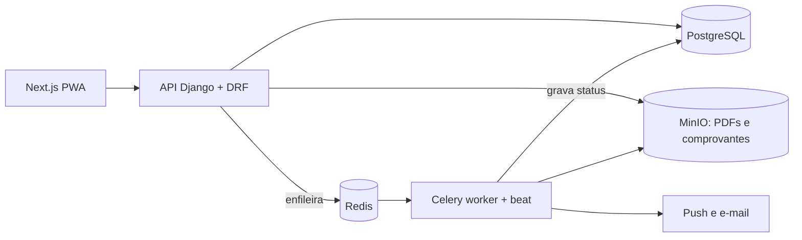

# Arquitetura — visão geral

> **Contém:** componentes do sistema e o fluxo API → fila → worker.
> **Origem:** `docs/especificacao-varal.md`, seção 9.

## 9. Arquitetura, stack e repositório

**Django + DRF + Celery no backend e Next.js no front**, num monorepo, rodando em Docker Compose na VPS. O ecossistema Python é mais forte em leitura de documentos, tarefas agendadas e, na v3, relatórios financeiros.

A API nunca espera a leitura de um PDF nem o envio de um aviso: ela enfileira a tarefa e responde na hora. O Celery beat dispara a rotina diária do CU12.

Stack e repositório: [stack.md](stack.md). Decisões: [adr/](adr/).
