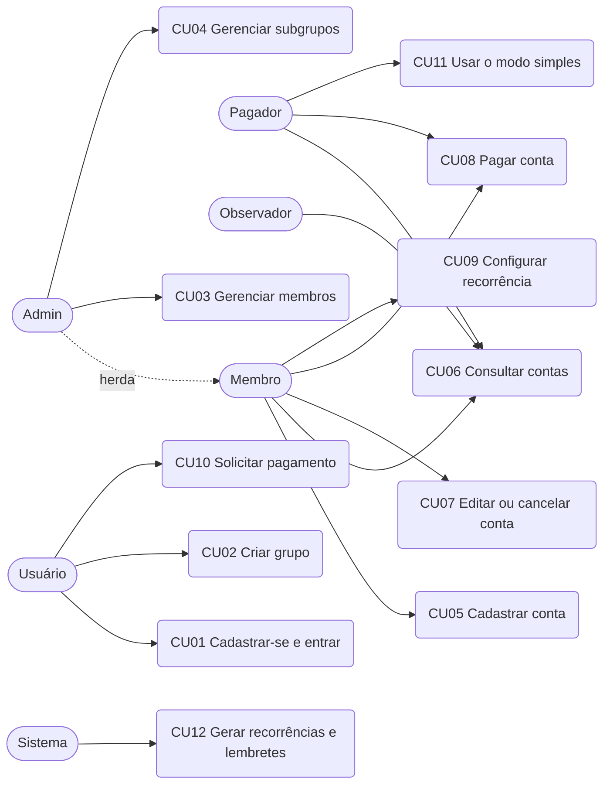

# Casos de uso

> **Contém:** diagrama de atores × casos de uso e a lista dos 12 CUs.
> **Origem:** `docs/especificacao-varal.md`, seção 6.

## 6. Casos de uso

Doze casos de uso cobrem o MVP; o Membro concentra o trabalho do dia a dia, e o Sistema garante os avisos sem depender de ninguém.

O diagrama original tem 5 atores (Usuário, Membro, Admin, Pagador, Sistema). O Observador foi
incluído porque o texto do CU06 o cita como ator.

No espaço pessoal, o dono tem as permissões de Membro e Admin ao mesmo tempo. As regras citadas (RN) estão na seção 7.

| ID | Caso de uso |
| --- | --- |
| [CU01](CU01-cadastrar-se-e-entrar.md) | Cadastrar-se e entrar |
| [CU02](CU02-criar-grupo.md) | Criar grupo |
| [CU03](CU03-gerenciar-membros.md) | Gerenciar membros |
| [CU04](CU04-gerenciar-subgrupos.md) | Gerenciar subgrupos |
| [CU05](CU05-cadastrar-conta.md) | Cadastrar conta |
| [CU06](CU06-consultar-contas.md) | Consultar contas |
| [CU07](CU07-editar-ou-cancelar-conta.md) | Editar ou cancelar conta |
| [CU08](CU08-pagar-conta.md) | Pagar conta |
| [CU09](CU09-configurar-recorrencia.md) | Configurar recorrência |
| [CU10](CU10-solicitar-pagamento.md) | Solicitar pagamento |
| [CU11](CU11-usar-o-modo-simples.md) | Usar o modo simples |
| [CU12](CU12-gerar-recorrencias-e-lembretes.md) | Gerar recorrências e lembretes |
