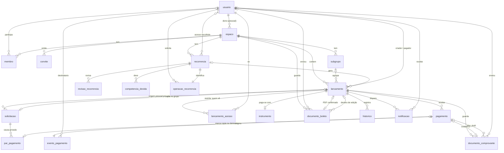

# Modelo de dados

> **Contém:** entidades, campos, decisões de modelagem e diagrama ER.
> **Origem:** `docs/especificacao-varal.md`, seção 8 (diagrama ER derivado das entidades), mais seções derivadas de implementação 02–11 e ADRs0005/0011–0015; etapa 11 em validação, sem modificar o trecho literal de origem.

## 8. Modelo de dados

A entidade central é o **lançamento**: no MVP todo lançamento é uma despesa, e a v3 passa a usar receitas sem mudar a estrutura.

```
usuario            id, nome, email, telefone, prefs_notificacao
espaco             id, tipo (pessoal|grupo), nome, dono_id, janela_alerta_dias
membro             espaco_id, usuario_id, papel (admin|membro|pagador|observador)
convite            id, espaco_id, papel, token, expira_em, usado_por?
subgrupo           id, espaco_id, nome, icone, arquivado, personalizada, versao
permissao_categoria id, subgrupo_id, membro_id, ver, criar, editar, pagar, recorrencias
historico_permissao id, subgrupo_id, autor_id?, criado_em, antes, depois
categoria          id, espaco_id?, nome, tipo (despesa|receita)

lancamento         id, espaco_id, subgrupo_id?, categoria_id?,
                   criador_id, pagador_id?, tipo (despesa|receita),
                   descricao, valor_centavos, vencimento,
                   status (aguardando|pendente|paga|confirmada|cancelada),
                   visibilidade (grupo|restrita), recorrencia_id?,
                   origem_id?                       -- solicitação: aponta para a conta pessoal
lancamento_acesso  lancamento_id, usuario_id        -- quem vê uma conta restrita
instrumento        lancamento_id, tipo (boleto_bancario|boleto_arrecadacao|pix|manual),
                   codigo, data_emissao?, pdf_url?, chave_pix?, beneficiario?
recorrencia        id, espaco_id, descricao, dia, valor_tipo (fixo|variavel),
                   valor_centavos?, subgrupo_id?, pagador_id?, ativa
pagamento          id, lancamento_id, pago_em, valor_pago_centavos,
                   marcado_por, comprovante_url?
historico          id, lancamento_id, usuario_id, acao, dados (jsonb), criado_em
notificacao        id, usuario_id, lancamento_id, tipo, canal, agendada_para,
                   enviada_em?, chave_idempotencia (única)
```

- **Centavos em inteiro**, nunca `float`.
- **Pagamento separado do lançamento:** permite pagamento parcial e, na v3, ligar o pagamento a uma carteira.
- **Instrumento separado:** novos meios de pagamento entram sem mexer em `lancamento`.
- **`chave_idempotencia` única** em `notificacao` garante RN19 e RNF07.
- **UUID** como chave em tudo; índice em `(espaco_id, vencimento)`.

**Categoria fora** ([ADR 0005](../arquitetura/adr/0005-rf11-sem-categoria.md)): a entidade `categoria` e `lancamento.categoria_id` do bloco acima (cópia da origem) não serão implementados no MVP, nem reservados para depois; categoria é conceito da v3.

## Implementação da Etapa 02

O bloco acima preserva a especificação. No código, `Usuario` mantém UUID/username legado e acrescenta `nome` (150 caracteres), `telefone` (30) e `prefs_notificacao` (JSON, padrão `{}`). O e-mail é normalizado ao salvar e tem restrição de unicidade sem distinguir maiúsculas.

`Espaco` já tem UUID, `tipo`, `nome`, `dono` e `janela_alerta_dias` (padrão 3). Para `pessoal`, o banco exige dono e unicidade por dono. `Usuario.save()` salva usuário e provisiona “Pessoal” na mesma transação, de forma idempotente. A migração `espacos.0002_pessoais_existentes` provisiona usuários anteriores sem trocar UUID/senha. Não há modelo de membros ainda; grupos e vínculos entram na Etapa 03. As tabelas de e-mail e conta social são mantidas pelo allauth.

## Implementação da Etapa 03

Difere do bloco da especificação (RN04, RN31 / [ADR 0004](../arquitetura/adr/0004-rn31-link-de-convite.md)):

- **`espaco`:** grupo **sem dono** (restrição `espaco_grupo_sem_dono`); quem administra é `membro` com papel admin. Todo grupo tem sempre ≥ 1 admin (serviços e guarda `pre_delete` em `Usuario`). Migração `0004` transforma dono legado de grupo em `membro` admin.
- **`membro`:** `id` UUID, `espaco`, `usuario`, `papel`, `criado_em`; único por `(espaco, usuario)` (`membro_unico_por_espaco`).
- **`convite`:** `token` não existe; guarda **`token_hash`** (SHA-256, único). Mais `expira_em` (criação + 7 dias), `usado_por?`, `usado_em?`, **`revogado_em?`**, `criado_por?`, `criado_em`. Pendente = sem uso, sem revogação e não expirado.
- **`subgrupo`** (categoria na UI, antes "casa"; [ADR 0016](../arquitetura/adr/0016-categorias-com-icone.md)): `id`, `espaco`, `nome`, `icone` (lista fechada `Icone`, padrão `casa`), `arquivado` (arquivar não apaga), `personalizada` e `versao` (COR-10).
- **`permissao_categoria`** ([ADR 0017](../arquitetura/adr/0017-permissoes-por-categoria.md)): o que um membro/observador pode fazer numa categoria personalizada; única por (`subgrupo`, `membro`), `CASCADE` nos dois; o banco recusa qualquer ação sem `ver`.
- **`historico_permissao`:** quem mudou (`autor`, `SET_NULL`), quando, e `antes`/`depois` só com ids e booleanos.

## Implementação da Etapa 04

Difere do bloco da especificação (RN30, RN32, ADR 0005–0009). App `api/apps/lancamentos`, migração `0001`; `espacos.0006` restringe `janela_alerta_dias` a 1–7 (RN13). A revisão delegada altera consultas, apresentação e travas, sem migração adicional.

- **`lancamento`:** `id`, `espaco` (`CASCADE`), `subgrupo?` (`RESTRICT`), `criador?` e `pagador?` (`SET_NULL`; criador nulo = "Ex-membro"), `descricao` (150), `valor_centavos` (> 0 no banco, RN11), `vencimento` (data civil), `status` (`aguardando|pendente|paga|confirmada|cancelada`, padrão `pendente`, validado no banco), `visibilidade` (`grupo|restrita`), `criado_em`, `atualizado_em`. Índice `(espaco, vencimento)`. Sem `categoria_id`, `tipo`, `recorrencia_id` nem `origem_id` (etapas futuras ou v3). `vence`/`vencida` não são gravados: `com_status` os calcula sobre `pendente` (RN12).
- **`lancamento_acesso`:** tabela do `ManyToMany` `acesso` (`lancamento_id`, `usuario_id`): os escolhidos de uma restrita (RN06). Quem vê = criador, pagador e escolhidos atuais; pagador do grupo só por pagador ou acesso explícito (ADR 0008). O campo de API **`quem_ve`** calcula essa audiência efetiva, sem duplicatas, sem criar tabela/campo gravado; `acesso` continua sendo a seleção editável. `quem_ve` é vazio para conta pessoal ou de visibilidade grupo.
- **`historico`:** `id`, `lancamento` (`CASCADE`), `usuario?` (`SET_NULL`), `acao`, `dados` (JSON), `criado_em`; ordem `criado_em`. Referências a pessoas em `dados` guardam **só ids de usuário**, nunca nome nem e-mail; a leitura resolve nome, "Pessoa sem nome" para membro atual sem nome ou "Ex-membro" para quem saiu/excluiu a conta. A casa vai pelo nome.

**Prazo não é estado gravado:** filtros/contagens de vencidas e da janela abrangem abertas `pendente`/`aguardando` pela data; o selo aguardando não muda ([ADR 0009](../arquitetura/adr/0009-filtro-temporal-contas-abertas.md)). `aguardando` nasce da recorrência variável na 08; o cadastro avulso das Etapas 05/06 não passa a criá-lo por aceitar código/PDF.

**Consistência e privacidade:** criar revalida autorização com travas de admins/membro; sair/remover/trocar papel considera todas as abertas em ordem de chave, inclusive públicas que possam ser convertidas em restritas. Exclusão de usuário trava admins de todos os grupos em que participa. Detalhe mantém a conta travada até serializar relações/histórico e revalida a autorização após adquirir a trava. O admin do Django filtra lançamentos/históricos pelo mesmo acesso, sem privilégio automático de superusuário; sua prévia de exclusão de usuário não expõe contas pessoais/restritas nem suas contagens.

| `acao` | Autor | `dados` |
| --- | --- | --- |
| `criada` | quem criou | `{}` |
| `editada` | quem editou | `{campo: [antes, depois]}` só do que mudou; `pagador` e `acesso` por id; na saída barrada, também `motivo: "saida_rn32"` (ADR 0007) |
| `cancelada` | quem cancelou | `{}`; na saída barrada, `motivo: "saida_rn32"` |
| `pagador_removido` | automática | `{pagador: [id, null]}` (RN21) |
| `acesso_removido` | automática | `{pessoa: id}`: a RN21 tirou alguém de "Quem vê" |
| `cancelada_automaticamente` | automática | `{motivo: "sem_quem_veja", removido: id}`: remoção pelo admin deixou a restrita sem ninguém (RN32); base do aviso da Etapa 09 |
| `acesso_preservado` | automática | `{motivo: "papel_pagador"}`: troca para pagador manteve o acesso (ADR 0008) |

Ações automáticas não têm autor e nunca aparecem como "Ex-membro". Na geração recorrente, `criada` com usuário nulo e competência interna é classificada por `Historico.automatica` como sistema (B08-4); criação manual com autor excluído permanece Ex-membro, sem inferir automação apenas pelo nulo.

## Implementação da Etapa 05

App `api/apps/boletos`, migração `boletos.0001_initial`; não modifica dados de contas manuais anteriores.

- **`instrumento`:** `lancamento` é OneToOne, chave primária UUID herdada da conta, `CASCADE`; `tipo` = `boleto_bancario|boleto_arrecadacao|pix`; `codigo` (até 4096), `chave_pix` (até 77) e `beneficiario` (até 25) aceitam `null`. Manual é ausência de relação, **não linha com tipo manual** nesta etapa; `ContaDetalhe.instrumento` retorna `null`.
- **Restrição `instrumento_tipo_conteudo_valido`:** bancário contém exatamente 47 dígitos ASCII; arrecadação começa com 8 e contém 48; Pix contém código não vazio ou chave não vazia, exclusivamente. DVs/CRC e semântica são revalidados no serviço; a restrição estrutural do banco não os substitui. Mesmo código pode existir em contas distintas, sem unicidade global.
- **Persistência:** boleto guarda dígitos normalizados; Pix copia e cola conserva o payload original, sem extrair chave para outro campo; chave avulsa guarda forma normalizada. Beneficiário pode vir do payload Pix e não significa identidade verificada. Data de emissão/arquivo PDF ficam para a 06.
- **Histórico:** criação/troca/remoção acrescenta `instrumento: [tipo_anterior, tipo_novo]` (manual quando ausente) e `codigo_alterado: true`; nunca código/chave integrais. A edição sem mudança não grava linha adicional. Troca/remoção só em aguardando/pendente; na Etapa 08 a promoção de aguardando exige confirmação explícita e dados completos, não só a existência do instrumento.
- **Coerência:** preview não persiste. Criar/editar revalida o instrumento, inclusive o preservado quando PATCH omite a relação, e confere valor/data finais na transação da conta. O fator ambíguo oferece as duas datas; somente uma data codificada pode ser salva, sem inferência pelo relógio ([decisões](../etapas/05-boleto-pix/decisoes.md)).
- **Privacidade:** relação é carregada só no detalhe autorizado e respostas de mutação; listas/resumos/históricos não carregam o payload. Sem registro independente no admin, e `__str__` não contém código/chave. A exclusão em cascata continua com prévia minimizada da 04.

## Implementação da Etapa 06

Migrações `boletos.0002_documentoboleto_limpezapdf_and_more` e `0003_documentoboleto_tentativa`, sem backfill destrutivo nas contas anteriores.

- **`documento_boleto`:** UUID; `espaco` CASCADE; `criado_por` SET_NULL; `destino` FK opcional CASCADE para intenção de edição; `lancamento` OneToOne opcional CASCADE para vínculo confirmado; `vinculado_em`, `estado`, `tentativa` UUID operacional, nome sanitizado (até 200), tamanho, `resultado`/`avisos` estruturados, criação/leitura. Destino não confirma vínculo. Uma vez vinculado, nunca retorna ao caminho privado do uploader; troca/remoção elimina/revoga o registro anterior.
- **Arquivos:** chave S3 e caminho de spool são derivados do UUID imutável, sem nome/e-mail/código do usuário. Não há URL pública persistida no modelo. Spool fica em volume privado compartilhado; django-storages faz I/O do objeto e um cliente configurado para o endpoint público assina links temporários.
- **`limpeza_pdf`:** UUID independente e data de criação; guarda intenção durável de eliminar a versão identificada, mesmo depois de apagar DocumentoBoleto. Não depende de FK viva. Limpeza só após commit; falha de fila/storage preserva a intenção para recuperação idempotente.
- **`instrumento`:** acrescenta tipo `manual` com código/chave nulos, `data_emissao` opcional e beneficiário até 200. Manual com PDF pode guardar metadados sem fabricar código; manual legado sem PDF continua sem relação. Restrições de boleto/Pix são preservadas. Beneficiário declarado no Pix continua vindo do payload, não identidade verificada.
- **Histórico:** vínculo/troca/remoção usa `pdf_alterado: true`; alteração efetiva de metadados usa `metadados_pdf_alterados: true`. Reenvio idêntico normalizado é no-op e a precedência do beneficiário Pix não cria falso histórico. Não grava nome do arquivo, PDF/texto integral, código/chave S3 ou URL assinada. Dados da conta/instrumento/vínculo/histórico são salvos na mesma transação.
- **Concorrência/recuperação:** `tentativa` distingue execuções antigas após recuperação; mutex operacional de objeto serializa PUT e limpeza sem segurar linha de conta/documento durante I/O externo. O worker só persiste resultado da tentativa atual e nunca altera conta salva. Cleanup tardio usa UUID antigo; rollback não dispara exclusão física. `recuperar_pdfs` retoma pendentes/leituras antigas, expira drafts de 24 h e recupera intenções.
- **Resultado:** JSON limitado e tipado, sem texto bruto. NUL, Unicode inválido, datas/valores/candidatos inconsistentes e saída excessiva são convertidos para resultado controlado antes do banco; a proteção não depende do serializer HTTP. Estado do processamento não cria status novo de lançamento, e cadastro avulso continua pendente.

Acesso a draft exige uploader e permissão atual no espaço/destino; documento vinculado usa somente o acesso atual à conta. Exclusão do uploader não elimina PDF de grupo por `criado_por`; exclusão da conta/espaço aciona limpeza após commit. Links já emitidos são credenciais por até 60 s, sem revogação instantânea prometida ([decisões06](../etapas/06-pdf-boleto/decisoes.md)).

## Implementação da Etapa 07 (em validação)

Migrações `pagamentos.0001_initial` e `lancamentos.0002_remove_historico_historico_acao_valida_and_more`; o bloco da origem acima não representa o contrato atual de comprovante nem habilita parcial no MVP ([ADR0011](../arquitetura/adr/0011-pagamento-e-evidencia.md)).

- **`pagamento`:** UUID, conta CASCADE, data civil `pago_em`, `valor_pago_centavos` >0, `marcado_por`, `pagador` do instante da marca e `desfeito_por` anuláveis SET_NULL, criação e `desfeito_em?`. Unicidade parcial por conta com `desfeito_em IS NULL`; uma marca integral ativa. Não guarda nomes/e-mails snapshots nem URL de arquivo.
- **`evento_pagamento`:** UUID, pagamento OneToOne CASCADE, destinatário anulável SET_NULL, criação e `processado_em?`. Criado atomicamente com a marca; anexo não duplica e undo não remove. Consumo/transporte na09, com revalidação de estado/acesso/destinatário, não entregue pela07.
- **`documento_comprovante`:** UUID, conta CASCADE, uploader SET_NULL, pagamento-alvo FK opcional e pagamento vinculado OneToOne opcional CASCADE, `versao`, `vinculado_em?`, `estado`, tentativaUUID, nome seguro (200), tamanho/MIME, criação/leitura. Enum `pendente|lendo|valido|invalido|erro`; distinto do status da conta. `lancamento.versao_pagamento` aumenta em marca/undo e impede reutilizar draft de ciclo antigo. Worker só valida documento, nunca confirma conta.
- **`limpeza_comprovante`:** UUID independente e criação; intenção durável por objeto, recuperada após commit sob mutex de I/O. Chave `comprovantes/{uuid}` e spool privado derivam doUUID, sem URL persistida. Alias S3 privado `comprovantes` recebe MIME validado JPEG/PNG/PDF; conserva original/EXIF, até5MiB e imagem até20MP sem animação. Sem limite de20 páginas importado do extrator de boleto; validação de comprovante usa processo com memória/CPU/tempo limitados.
- **Retenção:** undo mantém pagamento, comprovante e vínculo histórico imutável; nunca retorna a draft ou serve outra marca. A leitura depende da conta atual, inclusive para uploader/admin/observador. Sem troca/remoção isolada. Draft não vinculado expira em24h; exclusão física conta/espaço aciona limpeza após commit. URL dura60s e não promete revogação instantânea. Manutenção pelo beat a cada300s (D07-1); geração mensal passa a existir na Etapa 08, descrita abaixo.
- **Histórico:** `paga` guarda id do pagamento, data, valor e indicação de comprovante; `comprovante_anexado` e `pagamento_desfeito` referenciam pagamento. Reabertura pode registrar remoção do pagador sem vínculo atual. Sem nome de arquivo, URL, chaveS3 ou conteúdo integral. Referências pessoais continuam resolvidas sem e-mail histórico.

Métricas são projeções, não entidades novas: `pagas_qtd` em resumo/PorCasa e `contas_atribuidas_qtd` por membro, sempre pelo visível e mês de vencimento. Início/grupo usam mês atual; lista admite mês explícito. FK preservada de pagador sem membro atual integra filtro coletivo Ex-membro; FK nula é Sem pagador, sem reconstrução de identidade.

## Implementação da Etapa 08

[ADR 0012](../arquitetura/adr/0012-recorrencias-e-valores-desconhecidos.md), Q08-1–10/D08-1. Migrações `lancamentos.0003–0004` e `recorrencias.0001–0003` aplicadas em desenvolvimento; resultados finais no [relatório](../etapas/08-recorrencia-agendador/relatorio.md).

- **`recorrencia`:** UUID, espaço CASCADE, criador/pagador anuláveis SET_NULL, descrição (150), `dia_vencimento` 1–31, `valor_tipo` fixo/variavel, `valor_centavos?`, casa RESTRICT, visibilidade grupo/restrita e M2M acesso. Estado ativa/pausada/encerrada, motivo privado da pausa, cursor de competência e timestamps. Constraint exige positivo no fixo e NULL no variável. Não guarda instrumento, arquivo ou snapshot de identidade.
- **`revisao_recorrencia`:** FK CASCADE, competência inicial, patch JSON `alteracoes`, criação; aplicação em ordem de gravação preserva campos não alterados. Autorização, pagador, escolhidos e casa são revalidados pelo estado atual, sem ressuscitar concessão antiga.
- **`competencia_devida`:** FK CASCADE, competência no primeiro dia civil, estado pendente/bloqueada/gerada; única por modelo/mês. Materialização em lotes de 120 e cursor persistido preservam devidas anteriores à pausa/encerramento; retomada começa no mês corrente e não preenche meses pausados. Não há tabela adicional de intervalos.
- **`operacao_recorrencia`:** usuário CASCADE, chave UUID, hash SHA-256 da entrada, modelo OneToOne CASCADE e competência. Unicidade usuário/chave protege criação/retry; divergência é 409. IDs internos dessas três entidades operacionais usam a chave automática do Django, sem contrato público de UUID.
- **`lancamento`:** acrescenta `recorrencia?` RESTRICT e `competencia?`, obrigatoriamente pareados; competência no primeiro dia e única por modelo/mês. Valor passa a nullable: positivo é válido em qualquer status; NULL só em aguardando/cancelada, nunca zero/negativo. D08-1 preserva aguardando positivo legado sem backfill/promoção; variável nova nasce NULL pelo serviço. Conferência explícita promove na mesma transação da conta/instrumento/PDF/histórico.
- **Autoria e saída:** criador segue UUID/papel/vínculo atuais (Q08-10); reingresso elegível pode recuperar gestão mas exige retomada explícita. Saída retira pagador/escolhidos; reingresso/revisão antiga não os restaura. A FK experimental à participação foi removida por `recorrencias.0003`, preservando migrações já aplicadas.
- **Casa e evidência:** arquivamento move só abertas/modelos autorizados; finais/invisíveis guardam referência histórica. Geração de modelo com casa arquivada cria Sem casa. Código/PDF inicial pertence só à primeira cobrança confirmada, sem cópia para futuros meses. Modelo sem audiência válida pausa e mantém obrigação bloqueada privada.

## Implementação da Etapa 09

App `notificacoes`, migrações `0001–0005`; [ADR 0013](../arquitetura/adr/0013-notificacoes-privadas-e-entrega.md). Contrato público usa UUID para eventos/avisos/entregas/inscrições; controles operacionais usam chaves próprias.

- **EventoNotificacao:** UUID, chave única de origem, tipo, FKs opcionais SET_NULL para lançamento/pagamento/histórico, data-alvo, `snapshot_p7`, `canais_permitidos`, materialização/resultado e criação. Snapshot novo é mínimo (descrição/data/referência); legado sem descrição não é enriquecido. Todos os EventosPagamento da 07 são consumidos sem corte; legados RN21/P7 usam corte persistido e central somente.
- **Notificacao:** UUID, evento/destinatário CASCADE, lido/revogado/criação; única por evento/destinatário, índice de paginação por destinatário/criação/id. Revogação terminal. Excluir destinatário elimina seus avisos; conta invisível não concede privilégio por autoria/admin.
- **EntregaNotificacao:** UUID, aviso CASCADE, canal email/push, estado pendente/reservada/iniciada/aceita/descartada/falhou/incerta, tentativas, próxima execução, lease/token e resultado seguro. Única por aviso/canal; constraint de até três tentativas. Aceitação ambígua não volta automaticamente à fila.
- **SessaoPush:** chave fingerprint HMAC, usuário CASCADE, revogada/criação. **InstalacaoPush:** UUID interno, usuário/identificador UUID de cliente únicos, fingerprint da origem e tombstone revogada. DELETE só por identificador da instalação; pode anteceder POST em voo. Logout nativo revoga a sessão e ativa tombstones das instalações vinculadas.
- **InscricaoPush:** UUID, usuário CASCADE, fingerprint HMAC único da origem, sessão SET_NULL, segredo Fernet com endpoint/chaves, instalação UUID, geração, ativa e timestamps. Aliases de endpoint normalizados só para identidade; segredo conserva endpoint recebido; envio canonicaliza origem HTTPS/host minúsculo/443 implícita e preserva caminho/query opacos. Não há transferência automática entre usuários ou reativação por UUID tombstonado.
- **EntregaPushDispositivo:** UUID, entrega/inscrição CASCADE, geração, estado/tentativas/próxima/lease/token/resultado; única por entrega/inscrição/geração e até três tentativas. Inscrições elegíveis são congeladas na materialização; nova geração não recebe filhos antigos.
- **ControleNotificacoes:** chave/ativação persistida; migração `0002` fixa corte, não recalcula a cada deploy. **RodadaDiaria:** data-chave, geração/avisos concluídos, lease/token/timestamp; serializa geração 08 antes de avisos 09 com recuperação.

Projeção e autorizações permanecem no servidor até serializar. Preferências usam JSON versionado de Usuario; central não tem opt-out. Não se grava payload financeiro em push/e-mail ou logs. Segurança/auditoria sem bloqueantes, 483 pytest e 111 Vitest verdes; Playwright completo final verde (131 aprovados/3 skips), conforme [relatório](../etapas/09-notificacoes/relatorio.md).

## Diagrama ER



## Implementação da Etapa 10 — concluída

[ADR0014](../arquitetura/adr/0014-solicitacao-e-sincronizacao-privada.md), [relatório](../etapas/10-solicitacao-modo-simples/relatorio.md). A ligação de origem ilustrada no diagrama acima é materializada por `Solicitacao`, **não FK origem no Lancamento**. Sem entrega de exportação/exclusãoLGPD11 por esta integração.

- `Solicitacao`: UUID, origem e cópia SET_NULL (cópia OneToOne), solicitante/pagador inicial SET_NULL, grupo CASCADE, nonceUUID/corpo_hash64, snapshot privado confirmado, estado preparando/ativa/quitada/encerrada/falhou, tentativa/contagem/lease e datas. Uma viva por origem via constraint parcial, incluindo quitada; única solicitante/origem/nonce. Nenhum relacionamento é serializado como credencial de acesso à outra ponta.
- `TombstoneNonce`: solicitante/origem CASCADE, nonce e criação; unicidade dos três impede POST tardio após abandono. É ledger de recuperação autorizado no pessoal, não dado exposto ao grupo.
- `ParPagamento`: UUID que identifica causa canônica, solicitação PROTECT e marcas cópia/derivada OneToOne anuláveis SET_NULL. Preserva marcas exatas, sem criar pagamento independente da projeção. Boolean público `Pagamento.derivado` é calculado da relação; não coluna de autorização. Marca e undo projetados no pessoal têm autorNULL e marcador servidor automático/Sistema, sem UUID do ator do grupo no histórico pessoal.
- `EventoSolicitacao`: UUID, solicitação OneToOne CASCADE, destinatário SET_NULL, processamento/resultado/criação. Nascido apenas na ativação, com invalidação terminal. EventosPagamento por marca permanecem;09 seleciona evento canônico por causa/destinatário independentemente da ordem de consumo.
- `PinPDF` e `TentativaCopiaPDF`: identidades operacionais independentes de CASCADE pessoal, retenção de fonte, capacidade/token, destinoUUID por tentativa, integridade e incerteza. Não guardam snapshot financeiro deUI ou URL assinada. Fonte pinada sobrevive exclusão da linhaDocumento/usuário até publicação ou abandono seguro.
- `LimpezaPDF` e `LimpezaComprovante`: acrescentam geração/flag incerta. Intenção renovável antesPUT, cleanup com CAS da geração observada, sem rowlock de intenção/domínio duranteS3. Referência viva, pin ou writer legítimo impede remoção; resultado ambíguo conserva tombstone/reconciliação.

Migrações integradas/aplicadas no desenvolvimento segundo responsáveis: solicitacoes.0001, contas_usuario.0003, notificacoes.0006, boletos.0004 e pagamentos.0002. Prova isoladaORM/S3/Celery demonstrou CASCADE/preservação do compartilhamento aceito, não o fluxoLGPD11, identidade recente, exportação ou telaPerfil. Rodadas dirigidas/prova e limites estão no relatório; integral atual aprovada: 506 pytest, 127 Vitest, lint, tipos determinísticos e 143 E2E/três skips previstos.

## Implementação da Etapa 11

Extensão derivada do código em `api/apps/privacidade/models.py` e `contas_usuario/models.py`, regida pelo [ADR0015](../arquitetura/adr/0015-exportacao-exclusao-e-prova-local.md). O trecho da seção 8 acima continua a cópia de origem; esta seção descreve implementação adicional, sem reexportar ou reescrever a especificação. Categoria continua ausente do produto pelo ADR0005.

| Modelo | Campos e invariantes implementados |
| --- | --- |
| `RevisaoExportacao` | Singleton id=1, `epoca` UUID e `valor` inteiro monotônico transacional. Triggers incrementam R na mesma transação das fontes relevantes; rollback reverte incremento. Época muda na restauração reconciliada, invalidando jobs antigos |
| `Exportacao` | UUID, FK usuário CASCADE, `chave` UUID e hash do corpo, unicidade usuário/chave; criado/expira, estado pendente/processando/pronto/falhou/expirado; geração, tentativa UUID, lease, época/R capturados, objeto UUID, formato interno, SHA256 e manifestos. TTL absoluto 24 h desde o pedido |
| `ParteExportacao` | FK job CASCADE, tentativa, categoria técnica da projeção, cursor e JSON; unicidade job/tentativa/categoria/cursor. Staging privado por lote de 500; categoria aqui não é categoria financeira do ADR0005 |
| `IntencaoExclusao` | UUID, FK usuário CASCADE, hashes de segredo e sessão, expiração/consumo. O segredo só é entregue na criação; consumo ocorre no commit bem-sucedido, não no 409 |
| `OperacaoExclusao` | UUID sem FK de usuário, `owner_id` UUID opaco não derivado de e-mail, intenção UUID, criação e `publicada_em` (registro gravado no bucket, ADR 0018). Criada na mesma transação da exclusão; sobrevive a ela. Pseudônimo protegido, não dado anônimo |
| `LimpezaExportacao` | UUID do objeto, geração, flag incerta e criação. Intenção durável independente de job para cleanup após expiração/exclusão e reconciliação de escrita tardia |
| `TicketGoogle` | UUID, FK usuário CASCADE, tentativa UUID, expiração e consumo; ticket único de cinco minutos emitido após callback Google nativo validado pelo allauth |

O artefato privado usa **formato interno 2**, com blocos/manifestos/hash, sem alterar o contrato entregue: JSON externo `schema_version: 1`. Download prepara spool fora da barreira e revalida identidade/sessão/prova/TTL/ACL e, por último, R; depois libera a barreira antes da emissão pela rede. Revisão não substitui autorização nem relógio.

A barreira de domínio usa advisory lock transacional PostgreSQL de duas chaves `(0x56415241, 10)`, separado dos mutexes operacionais de objeto de chave bigint. Entra antes de locks de domínio; rede/S3/parser/SMTP/Push/journal não executam dentro dela. Leitores de R não usam row lock; isso isoladamente não elimina deadlock entre writers fora do protocolo. Triggers/inventário e coordenação de writers são partes da garantia, não um marcador universal allauth.

Exclusão valida RN04/RN32 do conjunto antes de efeitos pessoais. Grupo/evidências legítimos permanecem; referências de autoria estruturada tornam-se NULL/Ex-membro, sem promessa de remover menções livres/PDF/EXIF compartilhados. Pins e reservas aceitas 10 conservam somente snapshot/destino autorizados e nunca recriam pessoal. A exclusão inteira é uma transação; o registro externo e a restauração estão na [ADR 0018](../arquitetura/adr/0018-exclusao-e-backup-simples.md) e no [runbook](../arquitetura/backup-restauracao.md).

Modelos e migrações existentes não constituem aceite dos CAs. A preservação dos direitos de aceites posteriores ao target PITR está sob correção/prova integrada; restore não pode abrir só porque objetos ou ledger conferem.
