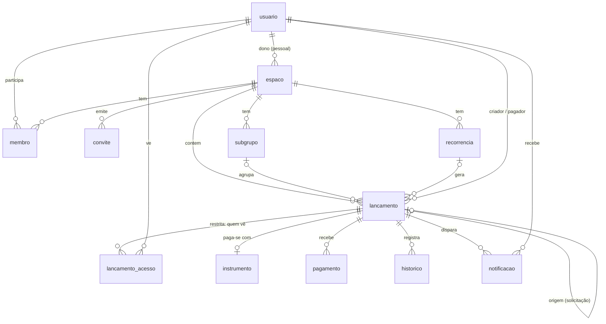

# Modelo de dados

> **Contém:** entidades, campos, decisões de modelagem e diagrama ER.
> **Origem:** `docs/especificacao-varal.md`, seção 8 (diagrama ER derivado das entidades), mais as seções de implementação das Etapas 02 e 03 e o ADR 0005 (sem categoria).

## 8. Modelo de dados

A entidade central é o **lançamento**: no MVP todo lançamento é uma despesa, e a v3 passa a usar receitas sem mudar a estrutura.

```
usuario            id, nome, email, telefone, prefs_notificacao
espaco             id, tipo (pessoal|grupo), nome, dono_id, janela_alerta_dias
membro             espaco_id, usuario_id, papel (admin|membro|pagador|observador)
convite            id, espaco_id, papel, token, expira_em, usado_por?
subgrupo           id, espaco_id, nome, arquivado
categoria          id, espaco_id?, nome, tipo (despesa|receita)

lancamento         id, espaco_id, subgrupo_id?, categoria_id?,
                   criador_id, pagador_id?, tipo (despesa|receita),
                   descricao, valor_centavos, vencimento,
                   status (aguardando|pendente|paga|confirmada|cancelada),
                   visibilidade (grupo|restrita), recorrencia_id?,
                   origem_id?                       -- solicitação: aponta para a conta pessoal
lancamento_acesso  lancamento_id, usuario_id        -- quem vê uma conta restrita
instrumento        lancamento_id, tipo (boleto_bancario|boleto_arrecadacao|pix|manual),
                   codigo, data_emissao?, pdf_url?, chave_pix?, beneficiario?
recorrencia        id, espaco_id, descricao, dia, valor_tipo (fixo|variavel),
                   valor_centavos?, subgrupo_id?, pagador_id?, ativa
pagamento          id, lancamento_id, pago_em, valor_pago_centavos,
                   marcado_por, comprovante_url?
historico          id, lancamento_id, usuario_id, acao, dados (jsonb), criado_em
notificacao        id, usuario_id, lancamento_id, tipo, canal, agendada_para,
                   enviada_em?, chave_idempotencia (única)
```

- **Centavos em inteiro**, nunca `float`.
- **Pagamento separado do lançamento:** permite pagamento parcial e, na v3, ligar o pagamento a uma carteira.
- **Instrumento separado:** novos meios de pagamento entram sem mexer em `lancamento`.
- **`chave_idempotencia` única** em `notificacao` garante RN19 e RNF07.
- **UUID** como chave em tudo; índice em `(espaco_id, vencimento)`.

**Categoria fora** ([ADR 0005](../arquitetura/adr/0005-rf11-sem-categoria.md)): a entidade `categoria` e `lancamento.categoria_id` do bloco acima (cópia da origem) não serão implementados no MVP, nem reservados para depois; categoria é conceito da v3.

## Implementação da Etapa 02

O bloco acima preserva a especificação. No código, `Usuario` mantém UUID/username legado e acrescenta `nome` (150 caracteres), `telefone` (30) e `prefs_notificacao` (JSON, padrão `{}`). O e-mail é normalizado ao salvar e tem restrição de unicidade sem distinguir maiúsculas.

`Espaco` já tem UUID, `tipo`, `nome`, `dono` e `janela_alerta_dias` (padrão 3). Para `pessoal`, o banco exige dono e unicidade por dono. `Usuario.save()` salva usuário e provisiona “Pessoal” na mesma transação, de forma idempotente. A migração `espacos.0002_pessoais_existentes` provisiona usuários anteriores sem trocar UUID/senha. Não há modelo de membros ainda; grupos e vínculos entram na Etapa 03. As tabelas de e-mail e conta social são mantidas pelo allauth.

## Implementação da Etapa 03

Difere do bloco da especificação (RN04, RN31 / [ADR 0004](../arquitetura/adr/0004-rn31-link-de-convite.md)):

- **`espaco`:** grupo **sem dono** (restrição `espaco_grupo_sem_dono`); quem administra é `membro` com papel admin. Todo grupo tem sempre ≥ 1 admin (serviços e guarda `pre_delete` em `Usuario`). Migração `0004` transforma dono legado de grupo em `membro` admin.
- **`membro`:** `id` UUID, `espaco`, `usuario`, `papel`, `criado_em`; único por `(espaco, usuario)` (`membro_unico_por_espaco`).
- **`convite`:** `token` não existe; guarda **`token_hash`** (SHA-256, único). Mais `expira_em` (criação + 7 dias), `usado_por?`, `usado_em?`, **`revogado_em?`**, `criado_por?`, `criado_em`. Pendente = sem uso, sem revogação e não expirado.
- **`subgrupo`** (casa): `id`, `espaco`, `nome`, `arquivado` (arquivar não apaga).

## Diagrama ER


