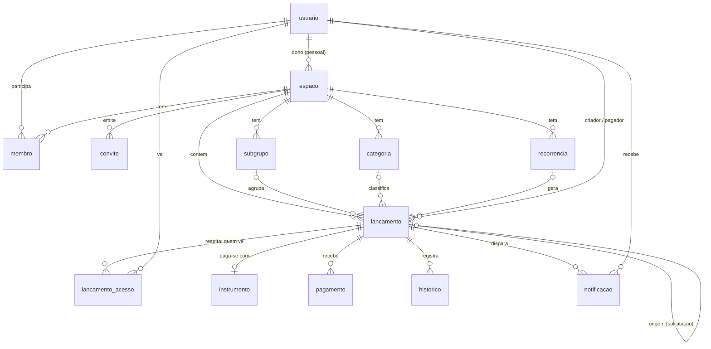

# Modelo de dados

> **Contém:** entidades, campos, decisões de modelagem e diagrama ER.
> **Origem:** `docs/especificacao-varal.md`, seção 8 (o diagrama ER foi derivado do bloco de entidades).

## 8. Modelo de dados

A entidade central é o **lançamento**: no MVP todo lançamento é uma despesa, e a v3 passa a usar receitas sem mudar a estrutura.

```
usuario            id, nome, email, telefone, prefs_notificacao
espaco             id, tipo (pessoal|grupo), nome, dono_id, janela_alerta_dias
membro             espaco_id, usuario_id, papel (admin|membro|pagador|observador)
convite            id, espaco_id, papel, token, expira_em, usado_por?
subgrupo           id, espaco_id, nome, arquivado
categoria          id, espaco_id?, nome, tipo (despesa|receita)

lancamento         id, espaco_id, subgrupo_id?, categoria_id?,
                   criador_id, pagador_id?, tipo (despesa|receita),
                   descricao, valor_centavos, vencimento,
                   status (aguardando|pendente|paga|confirmada|cancelada),
                   visibilidade (grupo|restrita), recorrencia_id?,
                   origem_id?                       -- solicitação: aponta para a conta pessoal
lancamento_acesso  lancamento_id, usuario_id        -- quem vê uma conta restrita
instrumento        lancamento_id, tipo (boleto_bancario|boleto_arrecadacao|pix|manual),
                   codigo, data_emissao?, pdf_url?, chave_pix?, beneficiario?
recorrencia        id, espaco_id, descricao, dia, valor_tipo (fixo|variavel),
                   valor_centavos?, subgrupo_id?, pagador_id?, ativa
pagamento          id, lancamento_id, pago_em, valor_pago_centavos,
                   marcado_por, comprovante_url?
historico          id, lancamento_id, usuario_id, acao, dados (jsonb), criado_em
notificacao        id, usuario_id, lancamento_id, tipo, canal, agendada_para,
                   enviada_em?, chave_idempotencia (única)
```

- **Centavos em inteiro**, nunca `float`.
- **Pagamento separado do lançamento:** permite pagamento parcial e, na v3, ligar o pagamento a uma carteira.
- **Instrumento separado:** novos meios de pagamento entram sem mexer em `lancamento`.
- **`chave_idempotencia` única** em `notificacao` garante RN19 e RNF07.
- **UUID** como chave em tudo; índice em `(espaco_id, vencimento)`.

## Diagrama ER


