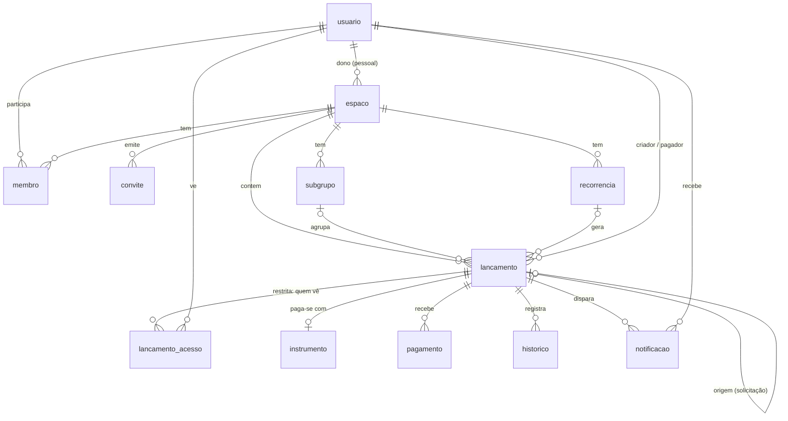

# Modelo de dados

> **Contém:** entidades, campos, decisões de modelagem e diagrama ER.
> **Origem:** `docs/especificacao-varal.md`, seção 8 (diagrama ER derivado das entidades), mais as seções de implementação das Etapas 02–05 e o ADR 0005 (sem categoria).

## 8. Modelo de dados

A entidade central é o **lançamento**: no MVP todo lançamento é uma despesa, e a v3 passa a usar receitas sem mudar a estrutura.

```
usuario            id, nome, email, telefone, prefs_notificacao
espaco             id, tipo (pessoal|grupo), nome, dono_id, janela_alerta_dias
membro             espaco_id, usuario_id, papel (admin|membro|pagador|observador)
convite            id, espaco_id, papel, token, expira_em, usado_por?
subgrupo           id, espaco_id, nome, arquivado
categoria          id, espaco_id?, nome, tipo (despesa|receita)

lancamento         id, espaco_id, subgrupo_id?, categoria_id?,
                   criador_id, pagador_id?, tipo (despesa|receita),
                   descricao, valor_centavos, vencimento,
                   status (aguardando|pendente|paga|confirmada|cancelada),
                   visibilidade (grupo|restrita), recorrencia_id?,
                   origem_id?                       -- solicitação: aponta para a conta pessoal
lancamento_acesso  lancamento_id, usuario_id        -- quem vê uma conta restrita
instrumento        lancamento_id, tipo (boleto_bancario|boleto_arrecadacao|pix|manual),
                   codigo, data_emissao?, pdf_url?, chave_pix?, beneficiario?
recorrencia        id, espaco_id, descricao, dia, valor_tipo (fixo|variavel),
                   valor_centavos?, subgrupo_id?, pagador_id?, ativa
pagamento          id, lancamento_id, pago_em, valor_pago_centavos,
                   marcado_por, comprovante_url?
historico          id, lancamento_id, usuario_id, acao, dados (jsonb), criado_em
notificacao        id, usuario_id, lancamento_id, tipo, canal, agendada_para,
                   enviada_em?, chave_idempotencia (única)
```

- **Centavos em inteiro**, nunca `float`.
- **Pagamento separado do lançamento:** permite pagamento parcial e, na v3, ligar o pagamento a uma carteira.
- **Instrumento separado:** novos meios de pagamento entram sem mexer em `lancamento`.
- **`chave_idempotencia` única** em `notificacao` garante RN19 e RNF07.
- **UUID** como chave em tudo; índice em `(espaco_id, vencimento)`.

**Categoria fora** ([ADR 0005](../arquitetura/adr/0005-rf11-sem-categoria.md)): a entidade `categoria` e `lancamento.categoria_id` do bloco acima (cópia da origem) não serão implementados no MVP, nem reservados para depois; categoria é conceito da v3.

## Implementação da Etapa 02

O bloco acima preserva a especificação. No código, `Usuario` mantém UUID/username legado e acrescenta `nome` (150 caracteres), `telefone` (30) e `prefs_notificacao` (JSON, padrão `{}`). O e-mail é normalizado ao salvar e tem restrição de unicidade sem distinguir maiúsculas.

`Espaco` já tem UUID, `tipo`, `nome`, `dono` e `janela_alerta_dias` (padrão 3). Para `pessoal`, o banco exige dono e unicidade por dono. `Usuario.save()` salva usuário e provisiona “Pessoal” na mesma transação, de forma idempotente. A migração `espacos.0002_pessoais_existentes` provisiona usuários anteriores sem trocar UUID/senha. Não há modelo de membros ainda; grupos e vínculos entram na Etapa 03. As tabelas de e-mail e conta social são mantidas pelo allauth.

## Implementação da Etapa 03

Difere do bloco da especificação (RN04, RN31 / [ADR 0004](../arquitetura/adr/0004-rn31-link-de-convite.md)):

- **`espaco`:** grupo **sem dono** (restrição `espaco_grupo_sem_dono`); quem administra é `membro` com papel admin. Todo grupo tem sempre ≥ 1 admin (serviços e guarda `pre_delete` em `Usuario`). Migração `0004` transforma dono legado de grupo em `membro` admin.
- **`membro`:** `id` UUID, `espaco`, `usuario`, `papel`, `criado_em`; único por `(espaco, usuario)` (`membro_unico_por_espaco`).
- **`convite`:** `token` não existe; guarda **`token_hash`** (SHA-256, único). Mais `expira_em` (criação + 7 dias), `usado_por?`, `usado_em?`, **`revogado_em?`**, `criado_por?`, `criado_em`. Pendente = sem uso, sem revogação e não expirado.
- **`subgrupo`** (casa): `id`, `espaco`, `nome`, `arquivado` (arquivar não apaga).

## Implementação da Etapa 04

Difere do bloco da especificação (RN30, RN32, ADR 0005–0009). App `api/apps/lancamentos`, migração `0001`; `espacos.0006` restringe `janela_alerta_dias` a 1–7 (RN13). A revisão delegada altera consultas, apresentação e travas, sem migração adicional.

- **`lancamento`:** `id`, `espaco` (`CASCADE`), `subgrupo?` (`RESTRICT`), `criador?` e `pagador?` (`SET_NULL`; criador nulo = "Ex-membro"), `descricao` (150), `valor_centavos` (> 0 no banco, RN11), `vencimento` (data civil), `status` (`aguardando|pendente|paga|confirmada|cancelada`, padrão `pendente`, validado no banco), `visibilidade` (`grupo|restrita`), `criado_em`, `atualizado_em`. Índice `(espaco, vencimento)`. Sem `categoria_id`, `tipo`, `recorrencia_id` nem `origem_id` (etapas futuras ou v3). `vence`/`vencida` não são gravados: `com_status` os calcula sobre `pendente` (RN12).
- **`lancamento_acesso`:** tabela do `ManyToMany` `acesso` (`lancamento_id`, `usuario_id`): os escolhidos de uma restrita (RN06). Quem vê = criador, pagador e escolhidos atuais; pagador do grupo só por pagador ou acesso explícito (ADR 0008). O campo de API **`quem_ve`** calcula essa audiência efetiva, sem duplicatas, sem criar tabela/campo gravado; `acesso` continua sendo a seleção editável. `quem_ve` é vazio para conta pessoal ou de visibilidade grupo.
- **`historico`:** `id`, `lancamento` (`CASCADE`), `usuario?` (`SET_NULL`), `acao`, `dados` (JSON), `criado_em`; ordem `criado_em`. Referências a pessoas em `dados` guardam **só ids de usuário**, nunca nome nem e-mail; a leitura resolve nome, "Pessoa sem nome" para membro atual sem nome ou "Ex-membro" para quem saiu/excluiu a conta. A casa vai pelo nome.

**Prazo não é estado gravado:** filtros/contagens de vencidas e da janela abrangem abertas `pendente`/`aguardando` pela data; o selo aguardando não muda ([ADR 0009](../arquitetura/adr/0009-filtro-temporal-contas-abertas.md)). `aguardando` nasce da recorrência variável na 08; o cadastro avulso das Etapas 05/06 não passa a criá-lo por aceitar código/PDF.

**Consistência e privacidade:** criar revalida autorização com travas de admins/membro; sair/remover/trocar papel considera todas as abertas em ordem de chave, inclusive públicas que possam ser convertidas em restritas. Exclusão de usuário trava admins de todos os grupos em que participa. Detalhe mantém a conta travada até serializar relações/histórico e revalida a autorização após adquirir a trava. O admin do Django filtra lançamentos/históricos pelo mesmo acesso, sem privilégio automático de superusuário; sua prévia de exclusão de usuário não expõe contas pessoais/restritas nem suas contagens.

| `acao` | Autor | `dados` |
| --- | --- | --- |
| `criada` | quem criou | `{}` |
| `editada` | quem editou | `{campo: [antes, depois]}` só do que mudou; `pagador` e `acesso` por id; na saída barrada, também `motivo: "saida_rn32"` (ADR 0007) |
| `cancelada` | quem cancelou | `{}`; na saída barrada, `motivo: "saida_rn32"` |
| `pagador_removido` | automática | `{pagador: [id, null]}` (RN21) |
| `acesso_removido` | automática | `{pessoa: id}`: a RN21 tirou alguém de "Quem vê" |
| `cancelada_automaticamente` | automática | `{motivo: "sem_quem_veja", removido: id}`: remoção pelo admin deixou a restrita sem ninguém (RN32); base do aviso da Etapa 09 |
| `acesso_preservado` | automática | `{motivo: "papel_pagador"}`: troca para pagador manteve o acesso (ADR 0008) |

Ações automáticas não têm autor e nunca aparecem como "Ex-membro".

## Implementação da Etapa 05

App `api/apps/boletos`, migração `boletos.0001_initial`; não modifica dados de contas manuais anteriores.

- **`instrumento`:** `lancamento` é OneToOne, chave primária UUID herdada da conta, `CASCADE`; `tipo` = `boleto_bancario|boleto_arrecadacao|pix`; `codigo` (até 4096), `chave_pix` (até 77) e `beneficiario` (até 25) aceitam `null`. Manual é ausência de relação, **não linha com tipo manual** nesta etapa; `ContaDetalhe.instrumento` retorna `null`.
- **Restrição `instrumento_tipo_conteudo_valido`:** bancário contém exatamente 47 dígitos ASCII; arrecadação começa com 8 e contém 48; Pix contém código não vazio ou chave não vazia, exclusivamente. DVs/CRC e semântica são revalidados no serviço; a restrição estrutural do banco não os substitui. Mesmo código pode existir em contas distintas, sem unicidade global.
- **Persistência:** boleto guarda dígitos normalizados; Pix copia e cola conserva o payload original, sem extrair chave para outro campo; chave avulsa guarda forma normalizada. Beneficiário pode vir do payload Pix e não significa identidade verificada. Data de emissão/arquivo PDF ficam para a 06.
- **Histórico:** criação/troca/remoção acrescenta `instrumento: [tipo_anterior, tipo_novo]` (manual quando ausente) e `codigo_alterado: true`; nunca código/chave integrais. A edição sem mudança não grava linha adicional. Troca/remoção só em aguardando/pendente; instrumento válido em aguardando promove a pendente atomicamente.
- **Coerência:** preview não persiste. Criar/editar revalida o instrumento, inclusive o preservado quando PATCH omite a relação, e confere valor/data finais na transação da conta. O fator ambíguo oferece as duas datas; somente uma data codificada pode ser salva, sem inferência pelo relógio ([decisões](../etapas/05-boleto-pix/decisoes.md)).
- **Privacidade:** relação é carregada só no detalhe autorizado e respostas de mutação; listas/resumos/históricos não carregam o payload. Sem registro independente no admin, e `__str__` não contém código/chave. A exclusão em cascata continua com prévia minimizada da 04.

## Diagrama ER


