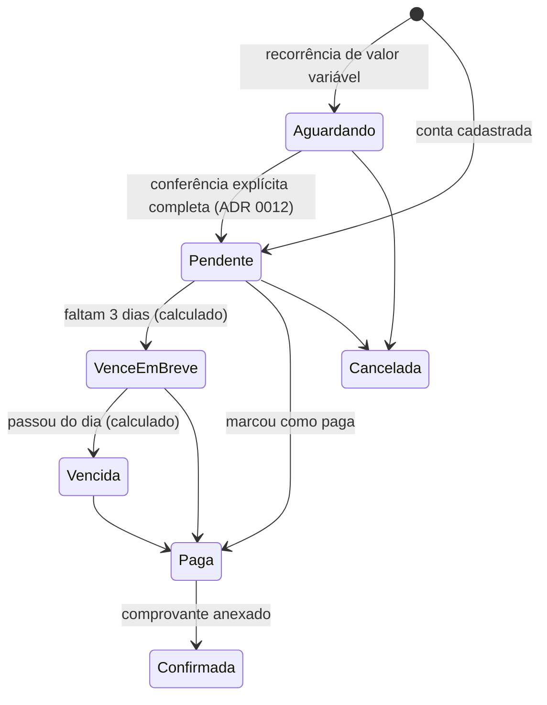

# Regras de negócio

> **Contém:** RN01–RN29 agrupadas por domínio, as regras acrescentadas por ADR (RN30–RN32), as exceções e precedências por ADR (RN05, RN06 × RN07) e o ciclo de status da conta.
> **Origem:** `docs/especificacao-varal.md`, seção 7.

## 7. Regras de negócio

Vinte e nove regras; as de espaço e visibilidade (RN01 a RN07) valem para toda consulta e toda escrita da API.

### Espaços, grupos e permissões

| ID | Regra |
| --- | --- |
| RN01 | Toda conta pertence a exatamente um espaço (pessoal ou grupo) e nunca aparece em outro. |
| RN02 | Uma conta do espaço pessoal só é vista pelo dono do espaço. |
| RN03 | Cada usuário tem um único espaço pessoal, criado no cadastro, que não aceita membros. |
| RN04 | Todo grupo tem pelo menos um admin; a última remoção ou rebaixamento de admin é bloqueada. |
| RN05 | Permissões por papel: Admin faz tudo; Membro cria, edita e paga; Pagador só paga as dele; Observador só vê. |
| RN06 | Conta com visibilidade restrita só é vista pelo criador, pelo pagador e pelos membros escolhidos. |
| RN07 | O Pagador só vê as contas em que é o pagador. |

### Cadastro de contas

| ID | Regra |
| --- | --- |
| RN08 | A linha digitável só é aceita se os dígitos verificadores (módulo 10 e 11) forem válidos. |
| RN09 | Boleto bancário (47 dígitos): valor e vencimento vêm do código; o fator de vencimento reiniciou em 22/02/2025 e o cálculo trata o ciclo novo. |
| RN10 | Boleto de concessionária (48 dígitos, começa com 8): o valor vem do código e o vencimento é informado pelo usuário. |
| RN11 | O valor deve ser maior que zero e é guardado em centavos. |

### Leitura do PDF do boleto

| ID | Regra |
| --- | --- |
| RN25 | Só arquivos PDF de até 5 MB. O PDF fica guardado e ligado à conta; trocar o arquivo refaz a leitura. |
| RN26 | A leitura usa o texto do PDF e procura a linha digitável (47 ou 48 dígitos, com ou sem pontos e espaços), validada pela RN08. |
| RN27 | Valor e vencimento vêm do código quando ele os traz (RN09). Do texto do PDF vêm a data de emissão ("Data do documento"), o vencimento de boletos de concessionária e o beneficiário. |
| RN28 | Se o texto do PDF divergir do código, vale o código e o usuário é avisado na conferência. PDF escaneado ou sem código válido é aceito e o usuário cola o código; leitura por OCR fica para a v2. |
| RN29 | Quem vê a conta pode baixar o PDF e copiar o código; o download usa link assinado de curta validade (RNF03). |

### Status e pagamento

| ID | Regra |
| --- | --- |
| RN12 | Ficam gravados Aguardando boleto, Pendente, Paga, Confirmada e Cancelada; "Vence em breve" e "Vencida" são calculados pela data na consulta. |
| RN13 | "Vence em breve" vale nos 3 dias antes do vencimento; o admin pode mudar para 1 a 7 dias no grupo. |
| RN14 | Marcar como paga exige a data do pagamento, que não pode ser futura. |
| RN15 | Uma conta Paga com comprovante anexado passa a Confirmada. |
| RN16 | Só quem marcou o pagamento ou um admin pode desfazê-lo. |

**Prazo e selo (Q04-26/Q04-35, [ADR 0009](../arquitetura/adr/0009-filtro-temporal-contas-abertas.md)):** filtros e contagens temporais incluem toda conta aberta (`pendente` ou `aguardando`): vencida se anterior a hoje; dentro da janela se entre hoje e hoje + RN13, inclusive, em Fortaleza. O selo `aguardando` permanece Aguardando; só `pendente` recebe `status_exibido=vence|vencida`. Nenhum estado novo é gravado. As consultas preservam a visibilidade e o período próprios de cada tela.

### Recorrência e lembretes

| ID | Regra |
| --- | --- |
| RN17 | A recorrência gera a ocorrência no primeiro dia do mês: de valor fixo nasce Pendente, de valor variável nasce Aguardando boleto. |
| RN18 | Se faltarem 5 dias para o vencimento e o boleto não tiver chegado, o criador e o pagador são avisados. |
| RN19 | Lembretes ao pagador 3 dias antes e no dia; 1 dia depois, sem pagamento, também ao criador e aos admins. Cada lembrete é enviado no máximo uma vez. |
| RN23 | Dia de vencimento 29, 30 ou 31 em um mês mais curto passa para o último dia desse mês. |

### Solicitação, saída e histórico

| ID | Regra |
| --- | --- |
| RN20 | A solicitação cria uma cópia no grupo ligada à original; pagar no grupo marca a original como Paga, e cancelar a original cancela a cópia. |
| RN21 | Quem sai do grupo deixa as contas que criou; as contas em que era pagador ficam sem pagador e o admin é avisado. |
| RN22 | Cancelar não apaga: a conta fica Cancelada, e toda alteração vai para o histórico com autor e data. |
| RN24 | O convite expira em 7 dias e pode ser usado uma vez. |

## Regras acrescentadas por ADR

Não estão na especificação; valem tanto quanto ela.

| ID | Regra | ADR | Etapa |
| --- | --- | --- | --- |
| RN30 | Exportar (JSON com perfil, contas do espaço pessoal, participações em grupos, avisos e links assinados dos PDFs) e excluir a própria conta (apaga o espaço pessoal e os arquivos; nos grupos, as contas criadas ficam com o autor "Ex-membro"; único admin precisa passar a administração antes). Detalha o RNF04. | [0003](../arquitetura/adr/0003-rn30-exportar-e-excluir-dados.md) | 11 |
| RN31 | Link de convite como credencial: token aleatório de no mínimo 128 bits, banco guarda só o hash, mostrado inteiro só na criação, uso único, 7 dias (RN24), revogável pelo admin, aceite limitado a 10 tentativas por usuário por hora (e por IP depois da P3), na tela sempre encurtado (`varal.app/c/9fKq2mXb…R4dT`). | [0004](../arquitetura/adr/0004-rn31-link-de-convite.md) | 03 |
| RN32 | Uma conta restrita aberta (aguardando ou pendente) nunca fica sem ninguém que a veja (RN06, RN07, calculado já com a RN21). Sair do grupo ou excluir a própria conta: bloqueado (409) até a pessoa escolher outra pessoa para ver ou cancelar a conta. Remoção pelo admin: nunca bloqueia; a conta é cancelada automaticamente ("ficou sem ninguém que pudesse vê-la"), sem nenhum sinal ao admin, e o removido é avisado (Etapa 09). Editar deixando a conta sem ninguém: recusado. Nunca escala a visibilidade para o admin. | [0006](../arquitetura/adr/0006-rn32-conta-restrita-orfa.md) | 04 |

### Exceções e precedências por ADR

| Regra | Exceção ou precedência | ADR | Etapa |
| --- | --- | --- | --- |
| RN05 | Quem é a última pessoa que vê uma conta restrita aberta pode, só dentro da própria saída do grupo barrada pela RN32, acrescentar alguém em "Quem vê" ou cancelar a conta; fica no histórico. Fora daí a RN05 vale inteira. | [0007](../arquitetura/adr/0007-rn05-excecao-saida-rn32.md) | 04 |
| RN06 × RN07 | Acesso explícito a uma restrita ("Quem vê") vale mais que a perda por papel: o pagador em "Quem vê" continua vendo a conta. Ao trocar alguém para pagador, a restrita aberta que só ele vê ganha o acesso explícito dele, com histórico. | [0008](../arquitetura/adr/0008-rn06-prevalece-sobre-rn07.md) | 04 |
| RN12 × RN13 | Prazo de vencidas/janela nos filtros e contagens considera abertas pendente e aguardando; o selo de aguardando não muda. | [0009](../arquitetura/adr/0009-filtro-temporal-contas-abertas.md) | 04 |

## Pagamento — precedências da Etapa 07

[ADR0011](../arquitetura/adr/0011-pagamento-e-evidencia.md), Q07-1–10: decisões delegadas, não alteração manual da especificação de origem. Implementação presente e ainda em validação no [relatório07](../etapas/07-pagamento/relatorio.md).

- **RF15/RN14:** somente integral, uma marca ativa por pendente; data civil obrigatória não futura em Fortaleza e valor integral esperado conferido sob trava. Não inicia pagamento bancário nem valida autenticidade do comprovante. Com marca ativa, mudança efetiva de valor da conta é409; outros campos mantêm as regras existentes.
- **RN05×RN16:** autor da marca ainda visível pode desfazer mesmo após virar observador/perder atribuição, sem ganhar pagar/upload/anexar. Admin também precisa ver a conta. Undo visa UUID exato, preserva marca/histórico e devolve pendente. Reabertura limpa pagador sem vínculo atual e recusa409 atomicamente se RN32 deixaria restrita órfã.
- **RN15:** comprovante opcional JPEG/PNG/PDF válido; vincular arquivo pronto e confirmar são atômicos, worker não altera conta. Anexo posterior só ao pagamento ativo sem arquivo, por autor/admin com permissão atual de pagar e acesso atual; sem troca/remoção isolada. Corrigir exige undo e nova marca.
- **RF16/RN22:** original/metadados preservados em storage privado, com aviso antes do envio; validação não atesta autenticidade. Undo conserva evidência histórica vinculada, legível por qualquer espectador atual, inclusive observador. Uploader não conserva privilégio após perder acesso. Não volta a draft, não confirma outra marca. Draft expira em24h; exclusão física limpa após commit. Assinatura de60s pode continuar válida até expirar depois da perda de acesso.
- **Q12/Q23/Q04-37:** progresso por quantidade paga+confirmada sobre não canceladas do mês de vencimento visível; aguardando entra no denominador, cancelada sai, vazio é0. MemberRow conta atribuições, não autoria. Ex-membro agrupa FK preservada sem vínculo atual; nulo segue Sem pagador. Nenhuma conta invisível cria contador/opção.
- **CU08/07→09:** marca gera EventoPagamento durável único, não aviso entregue. A09 revalida destinatário, visibilidade e marca ativa antes de consumir/entregar ou descartar; undo conserva evento. Exportação/exclusão integra-se na11 conforme RN30, sem ampliar visibilidade.

## Recorrência — precedências da Etapa 08

[ADR 0012](../arquitetura/adr/0012-recorrencias-e-valores-desconhecidos.md), Q08-1–10 e D08-1 detalham RN11/RN17/RN21/RN22/RN23 sem editar a origem. Implementação concluída; verificações finais no [relatório](../etapas/08-recorrencia-agendador/relatorio.md).

- Valor desconhecido é NULL somente em aguardando/cancelada; valor positivo legado em aguardando permanece, zero/negativo nunca são válidos. Novas variáveis começam aguardando/NULL. Total conhecido e quantidade a definir usam o mesmo universo visível; progresso conta aguardando.
- Criar/retomar torna atual elegível uma vez, mesmo vencida. Competência é civil/imutável; recuperação gera meses devidos em atividade, inclusive após pausa/encerramento, sem preencher meses pausados ou anteriores à criação. Dias 29–31 ajustam ao último dia válido.
- Aguardando só vira pendente por conferência explícita autorizada de valor/data completos, com código válido ou manual completo, inclusive PDF sem candidato conhecido. Upload/worker isolado não confirma. Repetir cobrança conferida cria modelo e uma única ocorrência atual atomicamente; código/PDF ficam só nela. Mês errado ou valor fixo divergente recusa sem perda do draft/formulário; retry idêntico não duplica.
- Só mês altera a ocorrência; próximos aplica campos pedidos nas abertas visíveis/editáveis pelo corte de competência, preservando finais, exceções anteriores e guardas de instrumento/PDF. Cancelar próximos encerra futuro e cancela abertas autorizadas do corte. Pausar/encerrar modelo isolado preserva geradas; encerramento é terminal.
- Geração revalida membros/audiência e retira pagador inelegível. Sem audiência, pausa privada mantém competência bloqueada sem acesso novo ao admin. Autor usa UUID/papel atuais no reingresso; pagador/escolhidos removidos não retornam por reingresso/revisão antiga e pausa não retoma sozinha.
- CU04 move abertas/modelos visíveis/editáveis para destino ativo ou Sem casa. Preview/contagem/resposta não revelam invisíveis; finais/invisíveis conservam casa histórica. Nova ocorrência com casa arquivada nasce Sem casa, sem perder cobrança. RN18 entrega avisos somente na Etapa 09.

## Notificações — precedências da Etapa 09

[ADR 0013](../arquitetura/adr/0013-notificacoes-privadas-e-entrega.md) e Q09-1–9/D09-1–3 detalham a execução sem editar a origem. RN18/RN19 usam D−5/D−3/D0/D+1 em Fortaleza, sem herdar janela visual RN13; abertas são aguardando/pendente. Conferência manual completa encerra ausência D−5; upload sozinho não.

Central única por evento/destinatário; leitura/contador/envio revalidam contexto e revogação é terminal. P7 só ao removido existente, com mínimo capturado no cancelamento e sem link à conta/PDF; legado sem snapshot usa referência/data/motivo, nunca descrição atual. RN21 exige conta ainda aberta/sem pagador e admin visível. P7 resolvida no fechamento da 09, com critérios backend/E2E verdes.

Consumir todos os EventosPagamento pendentes da 07 sem corte, se marca ativa/destinatário/acesso válidos. Legados RN21/P7 anteriores à ativação persistida ficam apenas na central. Lembretes recuperam só entre 07:00 e fim do próprio dia-alvo; mudanças/undo não recriam fase já consumida para a pessoa. Novos destinatários só dentro da janela, sem ressuscitar revogados.

Três tentativas totais por entrega/filho push (inicial e retries após 1 min/5 min), somente falha recuperável comprovada. Lease vencido após início sem resultado é incerto, sem retransmissão cega; aceito não é lido/entrega física. Opt-out/sem aparelho descarta canal sem retroativo ao reativar. Logout/sessão/instalação revogadas bloqueiam POST atrasado; novo ciclo exige UUID novo. Rotina única gera/recupera 08 antes de avisos 09; transporte usa conteúdo genérico e central autenticada.
