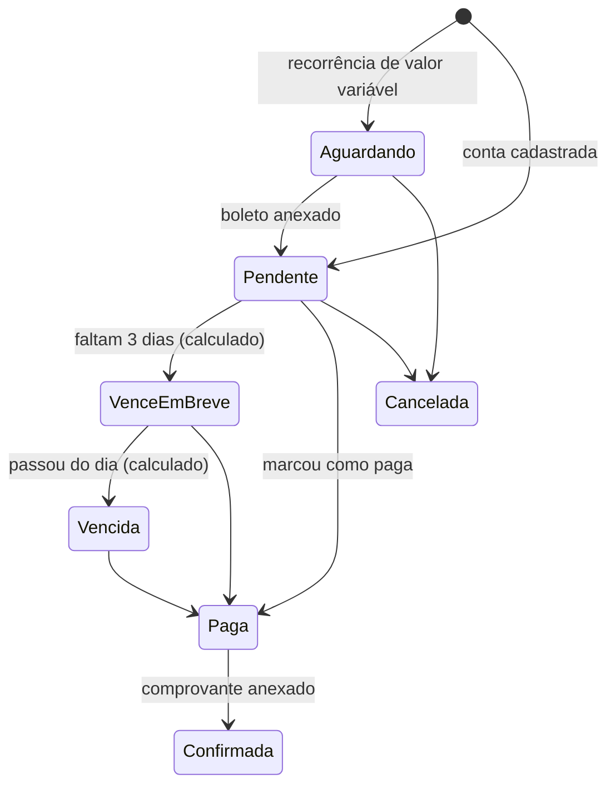

# Regras de negócio

> **Contém:** RN01–RN29 agrupadas por domínio, as regras acrescentadas por ADR (RN30–RN32), as exceções e precedências por ADR (RN05, RN06 × RN07) e o ciclo de status da conta.
> **Origem:** `docs/especificacao-varal.md`, seção 7.

## 7. Regras de negócio

Vinte e nove regras; as de espaço e visibilidade (RN01 a RN07) valem para toda consulta e toda escrita da API.

### Espaços, grupos e permissões

| ID | Regra |
| --- | --- |
| RN01 | Toda conta pertence a exatamente um espaço (pessoal ou grupo) e nunca aparece em outro. |
| RN02 | Uma conta do espaço pessoal só é vista pelo dono do espaço. |
| RN03 | Cada usuário tem um único espaço pessoal, criado no cadastro, que não aceita membros. |
| RN04 | Todo grupo tem pelo menos um admin; a última remoção ou rebaixamento de admin é bloqueada. |
| RN05 | Permissões por papel: Admin faz tudo; Membro cria, edita e paga; Pagador só paga as dele; Observador só vê. |
| RN06 | Conta com visibilidade restrita só é vista pelo criador, pelo pagador e pelos membros escolhidos. |
| RN07 | O Pagador só vê as contas em que é o pagador. |

### Cadastro de contas

| ID | Regra |
| --- | --- |
| RN08 | A linha digitável só é aceita se os dígitos verificadores (módulo 10 e 11) forem válidos. |
| RN09 | Boleto bancário (47 dígitos): valor e vencimento vêm do código; o fator de vencimento reiniciou em 22/02/2025 e o cálculo trata o ciclo novo. |
| RN10 | Boleto de concessionária (48 dígitos, começa com 8): o valor vem do código e o vencimento é informado pelo usuário. |
| RN11 | O valor deve ser maior que zero e é guardado em centavos. |

### Leitura do PDF do boleto

| ID | Regra |
| --- | --- |
| RN25 | Só arquivos PDF de até 5 MB. O PDF fica guardado e ligado à conta; trocar o arquivo refaz a leitura. |
| RN26 | A leitura usa o texto do PDF e procura a linha digitável (47 ou 48 dígitos, com ou sem pontos e espaços), validada pela RN08. |
| RN27 | Valor e vencimento vêm do código quando ele os traz (RN09). Do texto do PDF vêm a data de emissão ("Data do documento"), o vencimento de boletos de concessionária e o beneficiário. |
| RN28 | Se o texto do PDF divergir do código, vale o código e o usuário é avisado na conferência. PDF escaneado ou sem código válido é aceito e o usuário cola o código; leitura por OCR fica para a v2. |
| RN29 | Quem vê a conta pode baixar o PDF e copiar o código; o download usa link assinado de curta validade (RNF03). |

### Status e pagamento

| ID | Regra |
| --- | --- |
| RN12 | Ficam gravados Aguardando boleto, Pendente, Paga, Confirmada e Cancelada; "Vence em breve" e "Vencida" são calculados pela data na consulta. |
| RN13 | "Vence em breve" vale nos 3 dias antes do vencimento; o admin pode mudar para 1 a 7 dias no grupo. |
| RN14 | Marcar como paga exige a data do pagamento, que não pode ser futura. |
| RN15 | Uma conta Paga com comprovante anexado passa a Confirmada. |
| RN16 | Só quem marcou o pagamento ou um admin pode desfazê-lo. |

**Prazo e selo (Q04-26/Q04-35, [ADR 0009](../arquitetura/adr/0009-filtro-temporal-contas-abertas.md)):** filtros e contagens temporais incluem toda conta aberta (`pendente` ou `aguardando`): vencida se anterior a hoje; dentro da janela se entre hoje e hoje + RN13, inclusive, em Fortaleza. O selo `aguardando` permanece Aguardando; só `pendente` recebe `status_exibido=vence|vencida`. Nenhum estado novo é gravado. As consultas preservam a visibilidade e o período próprios de cada tela.

### Recorrência e lembretes

| ID | Regra |
| --- | --- |
| RN17 | A recorrência gera a ocorrência no primeiro dia do mês: de valor fixo nasce Pendente, de valor variável nasce Aguardando boleto. |
| RN18 | Se faltarem 5 dias para o vencimento e o boleto não tiver chegado, o criador e o pagador são avisados. |
| RN19 | Lembretes ao pagador 3 dias antes e no dia; 1 dia depois, sem pagamento, também ao criador e aos admins. Cada lembrete é enviado no máximo uma vez. |
| RN23 | Dia de vencimento 29, 30 ou 31 em um mês mais curto passa para o último dia desse mês. |

### Solicitação, saída e histórico

| ID | Regra |
| --- | --- |
| RN20 | A solicitação cria uma cópia no grupo ligada à original; pagar no grupo marca a original como Paga, e cancelar a original cancela a cópia. |
| RN21 | Quem sai do grupo deixa as contas que criou; as contas em que era pagador ficam sem pagador e o admin é avisado. |
| RN22 | Cancelar não apaga: a conta fica Cancelada, e toda alteração vai para o histórico com autor e data. |
| RN24 | O convite expira em 7 dias e pode ser usado uma vez. |

## Regras acrescentadas por ADR

Não estão na especificação; valem tanto quanto ela.

| ID | Regra | ADR | Etapa |
| --- | --- | --- | --- |
| RN30 | Exportar (JSON com perfil, contas do espaço pessoal, participações em grupos, avisos e links assinados dos PDFs) e excluir a própria conta (apaga o espaço pessoal e os arquivos; nos grupos, as contas criadas ficam com o autor "Ex-membro"; único admin precisa passar a administração antes). Detalha o RNF04. | [0003](../arquitetura/adr/0003-rn30-exportar-e-excluir-dados.md) | 11 |
| RN31 | Link de convite como credencial: token aleatório de no mínimo 128 bits, banco guarda só o hash, mostrado inteiro só na criação, uso único, 7 dias (RN24), revogável pelo admin, aceite limitado a 10 tentativas por usuário por hora (e por IP depois da P3), na tela sempre encurtado (`varal.app/c/9fKq2mXb…R4dT`). | [0004](../arquitetura/adr/0004-rn31-link-de-convite.md) | 03 |
| RN32 | Uma conta restrita aberta (aguardando ou pendente) nunca fica sem ninguém que a veja (RN06, RN07, calculado já com a RN21). Sair do grupo ou excluir a própria conta: bloqueado (409) até a pessoa escolher outra pessoa para ver ou cancelar a conta. Remoção pelo admin: nunca bloqueia; a conta é cancelada automaticamente ("ficou sem ninguém que pudesse vê-la"), sem nenhum sinal ao admin, e o removido é avisado (Etapa 09). Editar deixando a conta sem ninguém: recusado. Nunca escala a visibilidade para o admin. | [0006](../arquitetura/adr/0006-rn32-conta-restrita-orfa.md) | 04 |

### Exceções e precedências por ADR

| Regra | Exceção ou precedência | ADR | Etapa |
| --- | --- | --- | --- |
| RN05 | Quem é a última pessoa que vê uma conta restrita aberta pode, só dentro da própria saída do grupo barrada pela RN32, acrescentar alguém em "Quem vê" ou cancelar a conta; fica no histórico. Fora daí a RN05 vale inteira. | [0007](../arquitetura/adr/0007-rn05-excecao-saida-rn32.md) | 04 |
| RN06 × RN07 | Acesso explícito a uma restrita ("Quem vê") vale mais que a perda por papel: o pagador em "Quem vê" continua vendo a conta. Ao trocar alguém para pagador, a restrita aberta que só ele vê ganha o acesso explícito dele, com histórico. | [0008](../arquitetura/adr/0008-rn06-prevalece-sobre-rn07.md) | 04 |
| RN12 × RN13 | Prazo de vencidas/janela nos filtros e contagens considera abertas pendente e aguardando; o selo de aguardando não muda. | [0009](../arquitetura/adr/0009-filtro-temporal-contas-abertas.md) | 04 |
